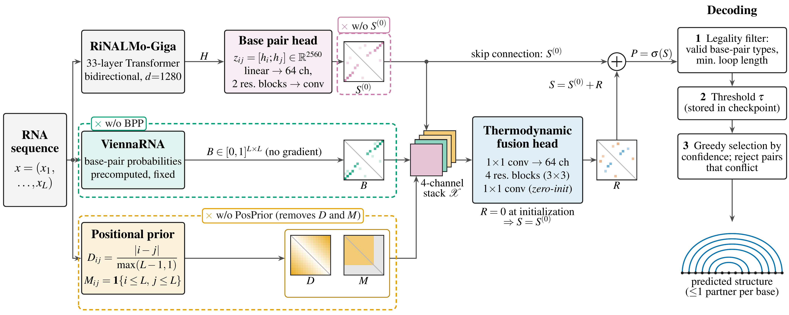

# RNA-Secondary-Structure-Predication

ThermoFusion 使用 RiNALMo-Giga 编码 RNA 序列，再将基础配对分数、ViennaRNA 碱基配对概率（BPP）、相对距离和有效位置掩码输入二维残差头。修正后的配对分数经过阈值过滤和贪心解码，得到 RNA 二级结构。



- [PyTorch 模型架构](src/model.py)
- [配对解码实现](src/decode.py)
- [模型架构、训练方法与完整结果](RESULTS.md)

## 训练与评估

ThermoFusion 在 RiNALMo-Giga 预训练权重上微调。训练从冻结编码器开始，每三轮逐步解冻最后 3、6、9、12 层，使用参考配对矩阵的上三角 BCE 作为损失。每轮在验证集上选择解码阈值，最终用验证集选出的检查点和阈值评估测试集。

| 目录 | 内容 |
| --- | --- |
| [`src/`](src/) | 模型、数据加载、训练损失、解码和 F1 指标 |
| [`scripts/`](scripts/) | 数据准备、ViennaRNA 缓存、训练、评估、推理与权重平均 |
| [`configs/`](configs/) | ArchiveII 九折、bpRNA 与消融 YAML |
| [`tests/`](tests/) | 使用合成 RNA 的 CPU 训练和评估测试 |

从仓库根目录执行，数据与权重路径见 [训练准备](TRAINING.md)。

```bash
python scripts/train.py --config configs/folds/method_bpp_5s.yaml
python scripts/train.py --config configs/ablations/tr0_thermo_s17.yaml
```

## 实验结果

下表摘自 [模型架构与消融结果](RESULTS.md)。F1 越高越好。ArchiveII 宏平均对九个 RNA 家族等权计算，每一折在其余八个家族上训练。

| 评估集 | 样本数 | RiNALMo | full | no-BPP | no-mask | no-S0 |
| --- | ---: | ---: | ---: | ---: | ---: | ---: |
| ArchiveII 九折宏平均 | 3,865 | 0.7059 ± 0.0061 | 0.7443 ± 0.0062 | 0.6583 ± 0.0065 | 0.6973 ± 0.0066 | 0.6647 ± 0.0067 |
| bpRNA TS0 | 1,305 | — | 0.7100 ± 0.0044 | 0.6942 ± 0.0045 | 0.7112 ± 0.0044 | 0.7016 ± 0.0044 |
| bpRNA-new | 5,401 | — | 0.5412 ± 0.0092 | 0.4177 ± 0.0091 | 0.5185 ± 0.0092 | 0.4953 ± 0.0092 |

ArchiveII 上，完整模型的宏平均 F1 比 RiNALMo 高 0.0384，优势主要集中在 Telomerase。BPP 与 S0 两项消融造成的宏平均降幅量级相当。bpRNA-new 上，移除 BPP 后 F1 从 0.5412 降至 0.4177。表中的 ± 数值沿用原文，结果解读见原文对噪声假设的讨论。

- [ArchiveII 逐家族结果 CSV](archiveii_ablation.csv)
- [bpRNA 测试结果 CSV](bprna_ablation.csv)
