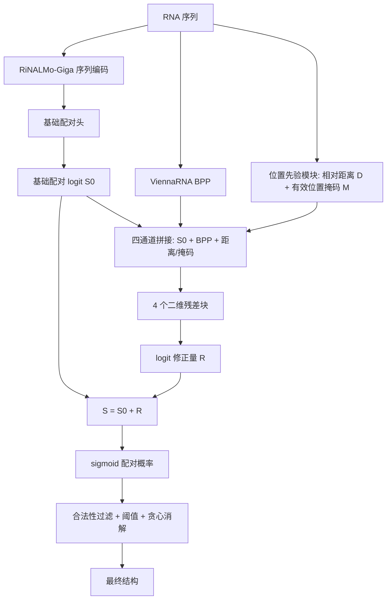

# RNA ThermoFusion 模型架构与消融结果

> **阅读说明**：本文保留模型架构、消融设置、ArchiveII 九折结果和 bpRNA 测试结果四个部分。评价指标为 **F1（越高越好）**。

## 1. 当前模型架构

模型输入是一条 RNA 序列 \(x=(x_1,\ldots,x_L)\)，输出一个 \(L\times L\) 的对称配对矩阵；每个核苷酸最多和另一个位置配对。整体流程是：

### 1.1 序列编码

序列先经过 RiNALMo-Giga 编码。它是 33 层 Transformer，隐藏维度 1280，注意力为双向注意力；每个核苷酸的最终表示不只由自己的碱基类型决定，还包含整条序列的上下文信息。设编码结果为

$$
H=[h_1,h_2,\ldots,h_L]\in\mathbb R^{L\times1280}.
$$

### 1.2 基础配对头

对每一对位置 \((i,j)\)，把 \(h_i\) 和 \(h_j\) 拼接起来：

$$
z_{ij}=[h_i;h_j]\in\mathbb R^{2560}.
$$

拼接结果先经线性层映射成 64 维二维特征图，再经过两个二维残差块和一个输出卷积，得到序列驱动的基础配对 logit \(S^{(0)}\)。这个头负责从序列上下文判断两个位置是否可能配对。

### 1.3 位置先验模块

位置先验模块由两个通道组成：

$$
D_{ij}=\frac{|i-j|}{\max(L-1,1)},\qquad
M_{ij}=\mathbf 1\{i\le L,\ j\le L\}.
$$

其中 \(D\) 是归一化相对距离，告诉二维卷积两个位置相隔多远；\(M\) 是有效位置掩码，用来区分真实核苷酸和批量补齐产生的 padding。对单条未补齐 RNA，\(M\) 是全 1 矩阵。

在当前模型里，相对距离和位置掩码被视为同一个模块，而不是两个独立消融项。它们不直接参与 logit 求和，而是作为修正头的输入通道，让模型在预测修正量时结合空间位置信息。

### 1.4 热力学融合修正头

ViennaRNA 先从输入序列预计算碱基配对概率矩阵 \(B\)。它是固定输入特征，训练时不反向传播到 ViennaRNA 参数。修正头把四个二维通道拼在一起：

$$
\mathcal X_{ij}=[S^{(0)}_{ij},B_{ij},D_{ij},M_{ij}].
$$

这个四通道特征先经 \(1\times1\) 卷积升到 64 通道，再经过四个二维残差块，最后用 \(1\times1\) 卷积输出修正量 \(R\)。因为中间用 \(3\times3\) 二维卷积，某个位置对的修正可以参考邻近配对区域的证据，而不是逐元素独立计算。

修正量直接加在基础 logit 上：

$$
S=S^{(0)}+R,\qquad P_{ij}=\sigma(S_{ij}).
$$

输出卷积在训练开始时初始化为零，因此训练初期 \(R=0\)，模型等价于只用基础配对头的输出；随后训练再学习如何根据 BPP、位置先验和基础分数修正预测。

### 1.5 解码

得到配对概率 \(P\) 后，解码过程分三步：

1. 只保留碱基类型合法、且满足最小环长约束的候选配对。
2. 用检查点中的阈值过滤低置信度配对。
3. 按置信度从高到低贪心选择配对；一个位置被选中后，其他与它冲突的配对不再接受。

最终输出满足对称、不自配对、每个位置最多一个配对伙伴的结构。

## 2. 消融设置

- **full**：完整模型，使用 \(S^{(0)}\)、BPP、相对距离和位置掩码。
- **no-BPP**：去掉 ViennaRNA 热力学 BPP 通道。
- **no-mask**：将相对距离和有效位置掩码作为一个位置先验模块整体移除。
- **no-S0**：消融序列驱动的基础配对分数 `S0` 分支，用于评估其对最终结构预测的贡献。

下列表格沿用当前材料记录的训练与解码协议。`RiNALMo` 为独立对照；`full` 为完整模型；`no-*` 为消融模型。**Δ = F1(full) − F1(对应消融)**，正值代表完整模型更好。

## 3. ArchiveII 九折结果

> **评测设置**：按九个 RNA family 汇总 F1；宏平均为九个 family 的等权均值，与样本量加权均值不同。每个 family 的结果来自单独训练的一折模型（在其余 8 个家族上训练）。

| Family | n | RiNALMo | full | no-BPP | Δ BPP | no-mask | Δ mask | no-S0 | Δ S0 |
|:---|---:|---:|---:|---:|---:|---:|---:|---:|---:|
| 5S | 1,283 | 0.8772 ± 0.0102 | 0.8799 ± 0.0101 | 0.8467 ± 0.0112 | +0.0332 ± 0.0151 | 0.8452 ± 0.0113 | +0.0347 ± 0.0151 | 0.8213 ± 0.0119 | +0.0586 ± 0.0156 |
| SRP | 918 | 0.6691 ± 0.0149 | 0.6827 ± 0.0147 | 0.6065 ± 0.0154 | +0.0762 ± 0.0213 | 0.6474 ± 0.0151 | +0.0353 ± 0.0211† | 0.6258 ± 0.0153 | +0.0569 ± 0.0212 |
| RNase P | 454 | 0.7833 ± 0.0137 | 0.7851 ± 0.0136 | 0.7262 ± 0.0148 | +0.0589 ± 0.0201 | 0.7533 ± 0.0143 | +0.0318 ± 0.0197† | 0.7041 ± 0.0151 | +0.0810 ± 0.0203 |
| tRNA | 557 | 0.9303 ± 0.0083 | 0.9492 ± 0.0072 | 0.9157 ± 0.0091 | +0.0335 ± 0.0115 | 0.9288 ± 0.0084 | +0.0204 ± 0.0110† | 0.9236 ± 0.0087 | +0.0256 ± 0.0112 |
| Telomerase | 35 | 0.1173 ± 0.0190 | 0.3200 ± 0.0275 | 0.1134 ± 0.0187 | +0.2066 ± 0.0332 | 0.2650 ± 0.0260 | +0.0550 ± 0.0378† | 0.1847 ± 0.0229 | +0.1353 ± 0.0358 |
| tmRNA | 462 | 0.7680 ± 0.0140 | 0.7606 ± 0.0141 | 0.6893 ± 0.0153 | +0.0713 ± 0.0208 | 0.6873 ± 0.0153 | +0.0733 ± 0.0208 | 0.6749 ± 0.0155 | +0.0857 ± 0.0210 |
| 16S | 67 | 0.7303 ± 0.0210 | 0.7612 ± 0.0202 | 0.6705 ± 0.0223 | +0.0907 ± 0.0301 | 0.6978 ± 0.0217 | +0.0634 ± 0.0297 | 0.6938 ± 0.0218 | +0.0674 ± 0.0297 |
| 23S | 15 | 0.8383 ± 0.0306 | 0.8727 ± 0.0277 | 0.7943 ± 0.0336 | +0.0784 ± 0.0435† | 0.8270 ± 0.0314 | +0.0457 ± 0.0419† | 0.7692 ± 0.0350 | +0.1035 ± 0.0446 |
| Group I intron | 74 | 0.6391 ± 0.0221 | 0.6875 ± 0.0213 | 0.5622 ± 0.0228 | +0.1253 ± 0.0312 | 0.6240 ± 0.0223 | +0.0635 ± 0.0308 | 0.5846 ± 0.0227 | +0.1029 ± 0.0311 |
| **九折宏平均** | **3,865** | **0.7059 ± 0.0061** | **0.7443 ± 0.0062** | **0.6583 ± 0.0065** | **+0.0860 ± 0.0090** | **0.6973 ± 0.0066** | **+0.0470 ± 0.0091** | **0.6647 ± 0.0067** | **+0.0797 ± 0.0092** |

**结果解读**

- **整体表现**：完整模型的九折宏平均 F1 为 **0.7443 ± 0.0062**，RiNALMo 对照为 **0.7059 ± 0.0061**，相差 **0.0384**（z ≈ 4.4），宏平均层面稳健。但这一优势约 59% 来自 Telomerase 一个家族（+0.2027，折合宏平均 +0.0225）；去掉 Telomerase 后，其余 8 个家族平均只高 **0.0179 ± 0.0089**（z ≈ 2.0）。逐家族看，除 Telomerase 外没有一个家族的差异超过 2 个 SD，tmRNA 上 full 还略低于 RiNALMo（−0.0074）。建议表述为“宏平均优于 RiNALMo，优势主要集中在 Telomerase”，而不是“各家族普遍优于”。

- **BPP 消融**：移除 BPP 后降至 **0.6583 ± 0.0065**，Δ = **+0.0860 ± 0.0090**（z ≈ 9.6），稳健，说明热力学配对概率提供了重要补充信息。但“BPP 是三个消融项中降幅最大的一个”**目前不成立**：no-BPP 与 no-S0 的宏平均只差 0.0064（z ≈ 0.7），即使真实噪声只有假设的一半，z 也只有 1.4；而且这点差距完全来自 Telomerase，去掉它后 Δ BPP = 0.0709、Δ S0 = 0.0727，排序反转。按 80% 功效估算，约需 19 个种子才能分辨两者。建议改写为“BPP 与 S0 的贡献量级相当，二者都明显大于位置先验”（这两项比较的 z 分别为 4.2 和 3.5）。

- **S0 消融**：移除 S0 后为 **0.6647 ± 0.0067**，Δ = **+0.0797 ± 0.0092**（z ≈ 8.7），稳健。九个家族的 Δ 均为正且都超过 2 个 SD，但 tRNA、16S、23S 只有约 2.3 个 SD，“各 family 均有下降”需要实测确认。Telomerase、23S 和 Group I intron 的 Δ 绝对值最大，但这三个家族样本量都较小（n = 35 / 15 / 74），Δ 的 SD 也是九个家族中最大的三个，差值的具体大小不确定性很高。

- **位置先验消融**：移除“相对距离 + 有效位置掩码”模块后降至 **0.6973 ± 0.0066**，Δ = **+0.0470 ± 0.0091**（z ≈ 5.2），宏平均层面稳健。但逐家族看，SRP、RNase P、tRNA、Telomerase、23S 五个家族的 Δ 都在 2 个 SD 以内（†）。该模块的作用主要体现在九折汇总上，单个家族的证据较弱。

## 4. bpRNA 外部测试结果

> **评测设置**：TS0 与 bpRNA-new 分别汇总 F1。TS0 与训练集同分布；bpRNA-new 由训练集中未出现的新家族组成。

| 数据集 | n | full | no-BPP | Δ BPP | no-mask | Δ mask | no-S0 | Δ S0 |
|:---|---:|---:|---:|---:|---:|---:|---:|---:|
| TS0 | 1,305 | 0.7100 ± 0.0044 | 0.6942 ± 0.0045 | +0.0158 ± 0.0063 | 0.7112 ± 0.0044 | −0.0012 ± 0.0062† | 0.7016 ± 0.0044 | +0.0084 ± 0.0062† |
| bpRNA-new | 5,401 | 0.5412 ± 0.0092 | 0.4177 ± 0.0091 | +0.1235 ± 0.0129 | 0.5185 ± 0.0092 | +0.0227 ± 0.0130† | 0.4953 ± 0.0092 | +0.0459 ± 0.0130 |

**结果解读**

- **BPP 消融**：bpRNA-new 上 Δ = **+0.1235 ± 0.0129**（z ≈ 9.5），稳健；TS0 上 Δ = **+0.0158 ± 0.0063**（z ≈ 2.5），倾向成立但需实测确认。“BPP 在 bpRNA-new 上的差异更大”这一对比（两个 Δ 相差 0.1077，z ≈ 7.5）稳健。
- **位置先验消融**：TS0 上 Δ = **−0.0012 ± 0.0062**，两者没有可分辨的差异；bpRNA-new 上 Δ = **+0.0227 ± 0.0130**（z ≈ 1.7），同样在噪声范围内。因此比“收益随数据集变化”更准确的表述是“在 bpRNA 两个测试集上均未观察到可分辨的效应”。bpRNA-new 的这一判定对噪声假设敏感：若真实噪声只有假设的一半，z 约为 3.5。
- **S0 消融**：bpRNA-new 上 no-S0 为 **0.4953 ± 0.0092**，Δ = **+0.0459 ± 0.0130**（z ≈ 3.5），稳健；TS0 上 no-S0 为 **0.7016 ± 0.0044**，Δ = **+0.0084 ± 0.0062**（z ≈ 1.3），在噪声范围内。
