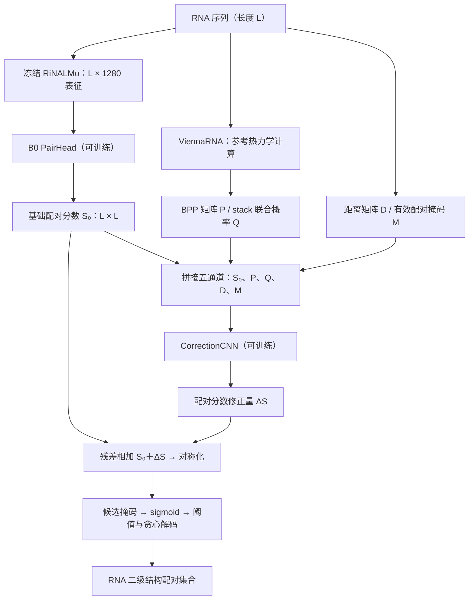

# RNA ThermoFusion FAST-v1 阶段实验汇报

汇报日期：2026年10月20日

**主要结论：BPP 热力学信息在家族留出开发集上带来稳定改善，值得继续验证；stack 联合概率的额外收益不稳定，当前不建议保留。** 本轮已完成三个共同种子的 9 组正式实验，以下结果均来自实际运行及核验。

## 1. 研究问题与对照设计

本项目考察热力学信息能否补充 RNA 预训练模型的序列表征，具体检验两个问题：加入碱基配对概率（BPP，记为 P）是否改善二级结构预测？进一步加入相邻两对碱基同时配对的联合概率（记为 Q），能否获得额外收益？

沿用固定划分：**3,299 条 RNA 用于监督训练，1,068 条 RNA、292 个留出家族组成 family-dev**。训练集与 family-dev 的序列和已知家族均无交叉，以考察对监督训练中未见家族的泛化能力。VL0 的 1,286 条 RNA 仅作辅助监测；本轮未运行 TS0 和 bpRNA-new 的预测与评价。

| 实验 | BPP 通道 P | stack 通道 Q | 对照目的 |
|---|---|---|---|
| E0：无热力学信息 | 全零 | 全零 | 同架构基线 |
| E1：BPP | 真实 P | 全零 | 衡量 BPP 的贡献 |
| E2：BPP + stack | 真实 P | 真实 Q | 衡量 Q 相对 BPP 的额外贡献 |

**E0 也保留完整的纠错 CNN。** 三组的网络结构、可训练参数量和训练协议相同，仅物理通道不同，因此主要依据 E1−E0 和 E2−E1 判断信息增益，不以历史 B0 的成绩代替本轮基线。

## 2. 模型具体架构

模型由**冻结的 RiNALMo 表征、可训练的 B0 配对预测头、可训练的热力学纠错 CNN，以及固定解码器**组成。设 RNA 长度为 L，整体数据流如下：



### 2.1 冻结表征与 B0 配对预测头

读取已有的通用预训练 RiNALMo 核苷酸表征 **H ∈ R^(L×1280)**，已去除 CLS/EOS，不更新 encoder。B0 head 将一维核苷酸表征转换为二维配对分数矩阵，具体结构如下。表中省略 batch 维度，卷积特征采用“通道数 × L × L”表示。

| 步骤 | 具体操作 | 输出维度 |
|---|---|---|
| 核苷酸投影 | LayerNorm(1280) → Linear(1280, 64) → GELU | L × 64 |
| 逐对特征构建 | 对每个位置对拼接 [zᵢ; zⱼ] | 128 × L × L |
| 通道压缩 | Conv2d(128, 64, kernel_size=1) | 64 × L × L |
| 残差块 1 | 两层 1×1 卷积，通道均为 64 | 64 × L × L |
| 残差块 2 | 两层 3×3 卷积，通道均为 64，padding=1 | 64 × L × L |
| 配对打分 | Conv2d(64, 1, kernel_size=1)，再对称化 | L × L |

每个残差块内部为：**Conv → InstanceNorm → ReLU → Conv → InstanceNorm → 残差相加 → ReLU**；InstanceNorm 含可训练仿射参数。打分矩阵通过 `(A + Aᵀ)/2` 得到对称的 S₀。

### 2.2 热力学残差纠错分支

纠错网络接收 **5 × L × L** 的输入，五个通道分别为：

- **S₀**：B0 head 的有限配对 logits，输入 CNN 前尚未施加无效位置屏蔽。
- **P**：碱基 i 与 j 配对的概率。
- **Q**：外层配对 (i,j) 与相邻内层配对 (i+1,j−1) 同时出现的联合概率。
- **D**：归一化位置距离，Dᵢⱼ = |i−j|/L。
- **M**：有效配对掩码，表示该位置对是否满足统一候选规则。

CorrectionCNN 的具体结构为：

```text
输入：5 × L × L
  → Conv2d(5, 32, kernel_size=3, padding=1) → GELU
  → Conv2d(32, 32, kernel_size=3, padding=1) → GELU
  → Conv2d(32, 1, kernel_size=1)
输出：ΔS，大小为 L × L
```

最后一层卷积的权重和偏置均零初始化，因此初始 ΔS=0，模型从原 B0 head 的输出开始学习纠错。最终融合分数为：

**S = [(S₀ + ΔS) + (S₀ + ΔS)ᵀ] / 2。**

随后施加统一候选掩码并解码。B0 head 与纠错 CNN 联合训练，可训练参数分别为 **175,553** 和 **10,753**，合计 **186,306**；冻结的 RiNALMo 参数不计入其中。

P 与 Q 使用 ViennaRNA 2.6.4，在 37°C、dangles=2、noLP=False、uniq_ML=True 的同一参考 ensemble 下计算，每条序列一次 partition function。Q 来自 `vrna_stack_prob` 的真实联合概率，不以 Pᵢⱼ×Pᵢ₊₁,ⱼ₋₁ 代替。已核验索引转换、概率范围及 Q 不超过对应边缘概率等约束。本轮训练、开发及辅助监测样本的表征与物理特征覆盖率均为 **100%**。

### 2.3 固定解码规则

对有效位置的融合分数取 sigmoid，保留高于所选阈值的候选配对，再按分数从高到低贪心接受。候选限定为 AU、GC、GU 及其反向配对，位置间隔满足 j−i≥4；每个核苷酸最多一个配对伙伴。解码器允许交叉配对，但 ViennaRNA 参考 ensemble 不包含带交叉配对的完整结构。

## 3. 训练协议与评价口径

三组使用共同种子 **17、23、41**；同一种子下的初始权重、数据顺序生成规则和训练预算一致。未载入旧全量 TR0 监督训练的 B0 checkpoint，避免其包含 family-dev 监督信息。

训练复用原 B0 的候选配对 BCE 损失，采用 AdamW，学习率 1×10⁻⁴、weight decay 1×10⁻⁴、batch size=1、梯度累积 4 步、梯度裁剪 1.0，并使用 BF16 混合精度。最多训练 10 轮，patience=3。训练损失仅在有效上三角候选位置计算。

主指标为 **family-dev 逐家族等权宏平均 exact F1**：先对家族内各 RNA 的 F1 求平均，再对家族等权平均，减少大样本家族对结果的主导。同时报告逐 RNA 宏 F1。配对位置须完全一致才算正确，**评价保留全部原始真值**，包括模型无法输出的非经典配对等困难标签。

阈值搜索范围预先固定为 0.1、0.2、…、0.9；仅依据 family-dev 主指标选择非初始 checkpoint 与阈值。分数相同时取较早 epoch、较低阈值，VL0 不参与选择。实际训练轮数为 8–10 轮。

## 4. 实验结果与结构分析

### 4.1 主要指标

| 方法 | 家族宏 exact F1（均值 ± 标准差） | RNA 宏 exact F1（均值） |
|---|---:|---:|
| E0：无热力学信息 | 0.5181 ± 0.0029 | 0.5089 |
| E1：BPP | **0.6223 ± 0.0013** | 0.5959 |
| E2：BPP + stack | 0.6228 ± 0.0015 | 0.5989 |

注：均值和标准差来自三个训练种子；标准差描述种子间波动，不代表置信区间或统计显著性。

**BPP 的收益稳定且覆盖较多家族。** E1 相对 E0 的家族宏 F1 平均增加 **0.1042（10.42 个百分点）**，RNA 宏 F1 增加 0.0869，三个种子均改善。292 个家族中，222 个家族的三种子平均 F1 提高，170 个家族在三个种子下均提高；另有 66 个家族平均下降。

| 种子 | BPP 增益：E1−E0 家族宏 F1 | Q 额外增益：E2−E1 家族宏 F1 |
|---|---:|---:|
| 17 | +0.10314 | +0.00294 |
| 23 | +0.10293 | −0.00124 |
| 41 | +0.10653 | −0.00013 |

**Q 的额外收益不足以支持保留。** E2 相对 E1 的家族宏 F1 平均仅增加 0.00052，且三个种子的变化方向不一致。按预先确定的规则，暂不保留 Q，也未追加配对概率乘积对照。这一结论适用于当前模型与训练协议，尚不能推广为联合概率信息普遍无效。

### 4.2 配对修复与 stem 恢复

E1 相对 E0 的配对变化如下。数值为三个种子的计数之和，同一 RNA 在不同种子下重复计数，真/错均依据完整原始真值判定。

| 补回真配对 | 删除错配对 | 新增错配对 | 误删真配对 |
|---:|---:|---:|---:|
| 20,369 | 24,169 | 28,428 | 7,312 |

汇总后净增加 **13,057 个真配对**，同时净增加 **4,259 个错配对**。因此，F1 提升体现为真配对恢复与误配之间的综合改善，不能解释为错误配对总量下降。

连续 stem 的完整恢复率由 E0 的 **28.58% 提高到 E1 的 38.96%**，E2 为 41.38%。Stem 定义为原始真值中至少包含三对连续相邻嵌套配对的最大片段，完整恢复要求片段内全部参考配对均预测正确。E2 在这一结构指标上更高，但其主指标相对 E1 的收益不稳定，故仍按预定主指标保留 E1。

## 5. 结论、证据边界与下一步

当前证据支持：**在统一架构和训练条件下，BPP 能有效补充冻结 RiNALMo 表征，改善留出家族的结构预测；Q 尚未提供一致的额外收益。**

需要保留三点限制：family-dev 同时用于 checkpoint 和阈值选择，因此当前属于开发结果，尚非独立最终测试结论；三个种子主要反映优化随机性，不能据此宣称统计显著性；家族留出针对本轮监督训练，不代表 RiNALMo 预训练从未见过相关 RNA 或家族。

建议以 **E1 作为后续候选方案**，固定当前架构、训练与评价口径，再开展全量 TR0 重训和预先约定的最终评价。本轮未执行这些后续阶段，也未开展九张扰动 BPP 实验。完整代码、checkpoint、逐 RNA 预测、逐家族分析及复现记录均已保存。
