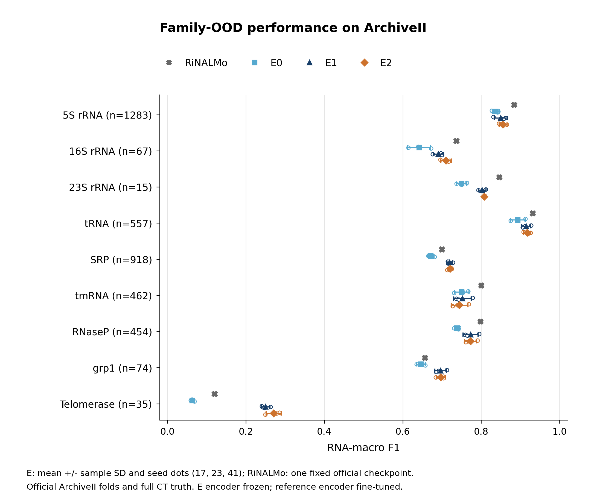
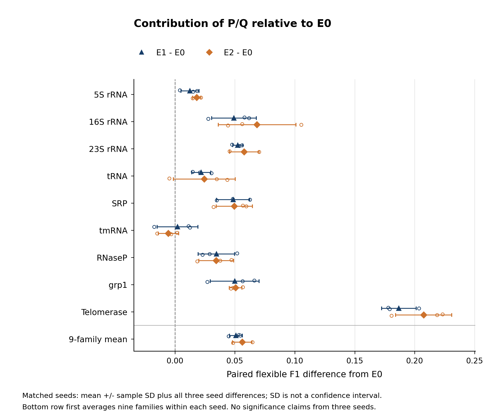
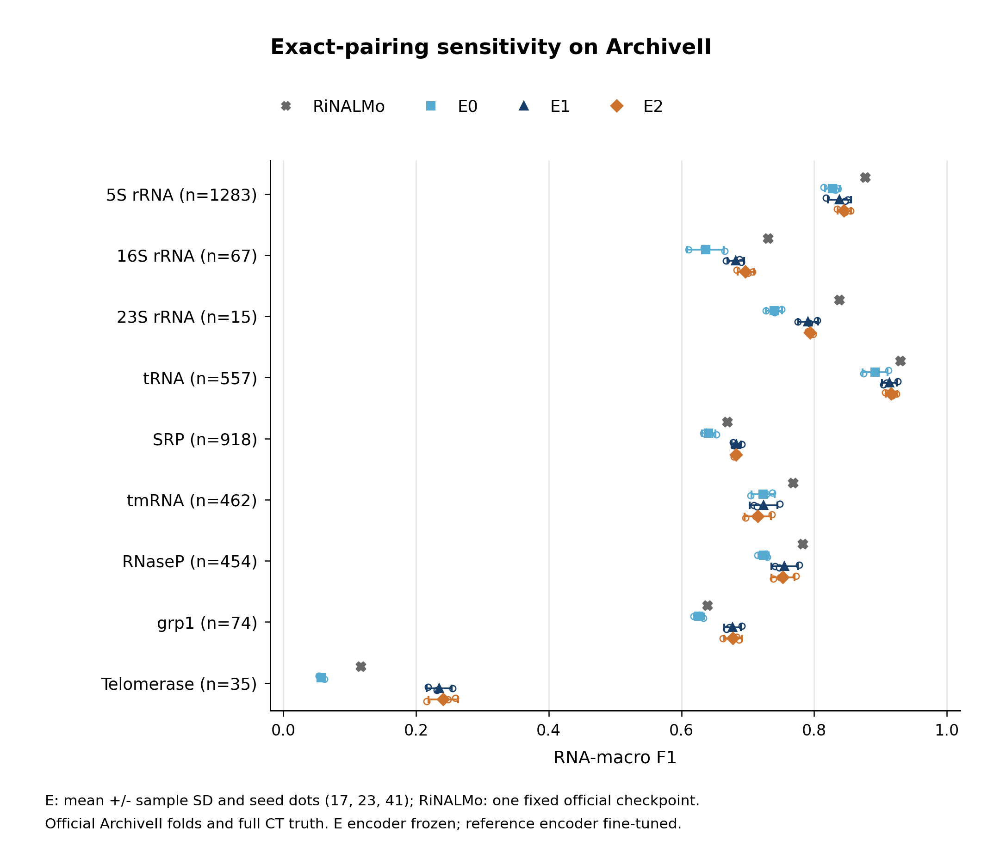

# ArchiveII Family-OOD：冻结E模型九折结果

全部81条E训练轨迹均已完成50轮，使用种子17、23、41及相同官方ArchiveII家族划分。全部81个仅按验证集得到的epoch和阈值选择统一锁定后执行E测试。九个官方微调检查点在相同测试CT上重评。独立复核90份预测文件、38650条逐RNA预测，原始真值完整保留。

## 各家族性能：官方允许1nt偏移的F1

每条RNA独立计算再在家族内平均。E为三种子均值±样本SD；官方RiNALMo为一个公开微调模型的实测重评估分数，不具有本轮三种子SD。

| 测试家族 | n | 官方RiNALMo | E0 | E1 | E2 |
|---|---:|---:|---:|---:|---:|
| 5s | 1283 | 0.884197 | 0.837305 ± 0.009216 | 0.849835 ± 0.016692 | 0.855517 ± 0.010163 |
| 16s | 67 | 0.737145 | 0.641961 ± 0.028941 | 0.691153 ± 0.013031 | 0.710456 ± 0.013097 |
| 23s | 15 | 0.846429 | 0.750206 ± 0.013544 | 0.802597 ± 0.009477 | 0.808029 ± 0.001237 |
| tRNA | 557 | 0.931275 | 0.892906 ± 0.018792 | 0.914783 ± 0.011246 | 0.917470 ± 0.008954 |
| srp | 918 | 0.699637 | 0.671097 ± 0.008875 | 0.719616 ± 0.007199 | 0.720547 ± 0.006239 |
| tmRNA | 462 | 0.800447 | 0.750264 ± 0.018435 | 0.752412 ± 0.022394 | 0.744836 ± 0.021209 |
| RNaseP | 454 | 0.798498 | 0.738482 ± 0.007102 | 0.773075 ± 0.019155 | 0.772987 ± 0.015408 |
| grp1 | 74 | 0.656578 | 0.646431 ± 0.011145 | 0.696263 ± 0.014655 | 0.697030 ± 0.011581 |
| telomerase | 35 | 0.120146 | 0.063354 ± 0.004769 | 0.250179 ± 0.011377 | 0.270882 ± 0.019176 |

## 完全精确配对的F1

| 测试家族 | n | 官方RiNALMo | E0 | E1 | E2 |
|---|---:|---:|---:|---:|---:|
| 5s | 1283 | 0.877187 | 0.827388 ± 0.011287 | 0.838194 ± 0.017598 | 0.845019 ± 0.010108 |
| 16s | 67 | 0.730348 | 0.636317 ± 0.027439 | 0.681677 ± 0.012495 | 0.696738 ± 0.011946 |
| 23s | 15 | 0.838255 | 0.739400 ± 0.012027 | 0.790929 ± 0.014752 | 0.793799 ± 0.004155 |
| tRNA | 557 | 0.930296 | 0.891834 ± 0.019023 | 0.913194 ± 0.011361 | 0.916158 ± 0.008693 |
| srp | 918 | 0.669097 | 0.640992 ± 0.010260 | 0.682583 ± 0.007192 | 0.682415 ± 0.002748 |
| tmRNA | 462 | 0.767976 | 0.722959 ± 0.017116 | 0.723655 ± 0.021029 | 0.715116 ± 0.020036 |
| RNaseP | 454 | 0.783265 | 0.723689 ± 0.007932 | 0.755318 ± 0.019600 | 0.753036 ± 0.017479 |
| grp1 | 74 | 0.639140 | 0.626267 ± 0.007372 | 0.676835 ± 0.012455 | 0.677415 ± 0.013230 |
| telomerase | 35 | 0.117275 | 0.056829 ± 0.004562 | 0.234680 ± 0.018705 | 0.241050 ± 0.022596 |

## 九轮汇总

九家族等权均值是主汇总。按RNA数量加权的均值会更受5S/SRP等大族影响，分别报告。E的汇总SD由每个种子的九家族汇总分数计算，不能解释为家族间SD或置信区间。

| 方法 | 九家族等权F1 | 按RNA数加权F1 | 九家族等权exact F1 |
|---|---:|---:|---:|
| RiNALMo_official | 0.719373 | 0.813095 | 0.705871 |
| E0_no_thermo | 0.665778 ± 0.006053 | 0.769441 ± 0.000832 | 0.651742 ± 0.005158 |
| E1_bpp | 0.716657 ± 0.005560 | 0.796299 ± 0.001899 | 0.699674 ± 0.004880 |
| E2_bpp_stack | 0.721973 ± 0.004305 | 0.798436 ± 0.004456 | 0.702305 ± 0.004152 |

## E部分的配对比较

相同家族、种子的E1/E2减E0。额外的物理信息是这组配对对比的受控变化。三个种子不用于宣称统计显著性。

| 家族 | 对比 | 配对F1差值均值 ± SD | 正差值种子数 |
|---|---|---:|---:|
| 5s | E1_bpp - E0_no_thermo | +0.012529 ± 0.007504 | 3/3 |
| 5s | E2_bpp_stack - E0_no_thermo | +0.018212 ± 0.003433 | 3/3 |
| 16s | E1_bpp - E0_no_thermo | +0.049192 ± 0.018603 | 3/3 |
| 16s | E2_bpp_stack - E0_no_thermo | +0.068495 ± 0.032355 | 3/3 |
| 23s | E1_bpp - E0_no_thermo | +0.052392 ± 0.004255 | 3/3 |
| 23s | E2_bpp_stack - E0_no_thermo | +0.057824 ± 0.012312 | 3/3 |
| tRNA | E1_bpp - E0_no_thermo | +0.021877 ± 0.007912 | 3/3 |
| tRNA | E2_bpp_stack - E0_no_thermo | +0.024564 ± 0.025783 | 2/3 |
| srp | E1_bpp - E0_no_thermo | +0.048519 ± 0.013808 | 3/3 |
| srp | E2_bpp_stack - E0_no_thermo | +0.049450 ± 0.015104 | 3/3 |
| tmRNA | E1_bpp - E0_no_thermo | +0.002148 ± 0.016929 | 2/3 |
| tmRNA | E2_bpp_stack - E0_no_thermo | -0.005428 ± 0.008480 | 1/3 |
| RNaseP | E1_bpp - E0_no_thermo | +0.034593 ± 0.015212 | 3/3 |
| RNaseP | E2_bpp_stack - E0_no_thermo | +0.034505 ± 0.014512 | 3/3 |
| grp1 | E1_bpp - E0_no_thermo | +0.049832 ± 0.020372 | 3/3 |
| grp1 | E2_bpp_stack - E0_no_thermo | +0.050599 ± 0.005279 | 3/3 |
| telomerase | E1_bpp - E0_no_thermo | +0.186825 ± 0.014449 | 3/3 |
| telomerase | E2_bpp_stack - E0_no_thermo | +0.207528 ± 0.023377 | 3/3 |
| ALL_9_equal_family | E1_bpp - E0_no_thermo | +0.050878 ± 0.005302 | 3/3 |
| ALL_9_equal_family | E2_bpp_stack - E0_no_thermo | +0.056194 ± 0.008141 | 3/3 |

## 数据和对比边界

本轮严格采用用户确认的“冻结编码器、50轮、仅替换数据”方案，保留原E的AdamW、候选BCE、BF16计算、0.1–0.9阈值网格及验证exact F1选模规则。官方RiNALMo基线具有微调后的编码器、原生预测头及其发布阈值；它与E使用同一测试数据和指标，但训练方式与架构不同，不能把两者的全部差异归因于纠错模块。

官方数据包括3865条RNA、3354条唯一序列；保留官方train/valid/test成员，无新增去重、长度过滤或裁剪。16S/23S是该基准提供的domain。官方train/valid中的重复序列组保留并在split_audit.json披露，测试角色没有相同序列组。五条空真值RNA保留：官方报告指标的空/空分数为0，原E验证选模函数的空/空分数为1，两个用途不混称同一数值。Family-OOD指监督阶段的家族留出，不声称通用语言模型预训练排除了测试家族。

数据与协议来源、样本数及重现命令见 [实验协议](../../docs/ARCHIVEII_FROZEN_PROTOCOL.md)。每折每条RNA的角色及CT哈希见fold_membership.csv.gz；逐种子结果、4050条逐轮曲线、配对差值、选择锁定及源代码/输入指纹随报告保存。

## 计算成本与运行问题

81条轨迹保留的完整训练段累计 51.31 GPU小时，验证段累计 4.85 小时。全部列入审计的准备/训练/测试/验证尝试累计单GPU分配时间为 59.25 小时；包含历史失败尝试，不含登录节点CPU预处理、网络下载与排队。这些是累计资源时间，不能当成用户等待的墙钟时间，也不据不同节点负载比较算法效率。

首次表征准备已算完表示，但记录安装来源时遇到namespace package没有__file__的问题。改用包搜索路径后回归测试通过，重新运行并验收准备。作业9218失败；依赖烟雾检查9219实际启动后因缺少embedding_provenance.json失败，原先“已取消”的中间记录已依据Slurm最终状态和错误日志更正，见historical_preparation_correction.json。后续准备9220及烟雾检查9221成功，旧产物单独保留。官方权重采用分块恢复下载，公开MD5与本地SHA256校验通过后才进入基线评估。同一官方权重的1MiB读取探测中，记录页入口6.2秒、API入口28.7秒，字节哈希一致。因此恢复下载时改用官方记录页文件入口，保留既有分块、相同Range及最终MD5校验；该探测不用于推断整批权重或训练的加速比例。详情见download_transport_change.json。

## 图表和产物

图表由真实family_results.csv/run_results.csv生成，E显示三种子的均值、样本SD和各种子点，官方检查点单独标记。SVG/PDF/PNG及实际QA记录位于figures/；自动检查不替代最终人工审阅。模型和逐RNA预测位于服务器outputs/archiveii_frozen/。

## 结果解读与训练轮数代价

E1、E2 的九家族等权 flexible F1 相对 E0 分别变化 +5.09、+5.62 个百分点。E1/E2 的家族均值分别在 9/9、8/9 个家族高于 E0；tmRNA 上 E2 相对 E0 变化 -0.54 个百分点。端粒酶家族只有 35 条 RNA，E2 相对 E0 的变化为 +20.75 个百分点，应结合小家族规模理解总体宏平均。

E2 的等权 flexible F1 为 0.721973，官方基线为 0.719373，均值差 +0.26 个百分点；E2 三种子 SD 为 0.004305，且官方只有一个固定模型，不能据此宣称稳定超越。按 RNA 数量加权时官方为 0.813095，E2 为 0.798436；exact F1 等权均值分别为 0.705871 和 0.702305。E1/E2 均值均高于官方的家族为：grp1, srp, telomerase。

下表描述同一批 81 条固定 50 轮轨迹的中途状态，每个方法在九家族和三个种子间等权平均。轮末验证 F1 与预算内验证峰值均为原 E 的 exact 验证口径，不是测试分数；没有为这些中间预算追加测试或重新选择最终方案。BCE 为候选配对损失，训练值是在线更新均值，不能直接解释成全矩阵准确率。

| 方法 | 轮数 | 训练 BCE | 验证 BCE | 轮末验证 F1 | 预算内验证峰值 | 累计训练+验证分钟/轨迹 |
|---|---:|---:|---:|---:|---:|---:|
| E0 | 10 | 0.002614 | 0.003919 | 0.923493 | 0.923572 | 8.58 |
| E0 | 30 | 0.001087 | 0.004116 | 0.937139 | 0.938332 | 25.11 |
| E0 | 50 | 0.000667 | 0.004608 | 0.939361 | 0.941992 | 41.64 |
| E1 | 10 | 0.002294 | 0.003599 | 0.933600 | 0.933817 | 8.57 |
| E1 | 30 | 0.000983 | 0.003878 | 0.943324 | 0.944594 | 25.16 |
| E1 | 50 | 0.000561 | 0.004450 | 0.945061 | 0.947391 | 41.64 |
| E2 | 10 | 0.002290 | 0.003567 | 0.933051 | 0.933270 | 8.56 |
| E2 | 30 | 0.000963 | 0.003853 | 0.943604 | 0.944740 | 25.06 |
| E2 | 50 | 0.000594 | 0.004309 | 0.945584 | 0.947818 | 41.50 |

| 方法 | 最佳验证轮数中位数 | 最佳轮数 >30 的轨迹 /27 | 30→50 平均额外分钟/轨迹 | 30→50 验证峰值均值增量 |
|---|---:|---:|---:|---:|
| E0 | 47 | 27/27 | 16.53 | +0.003659 |
| E1 | 46 | 27/27 | 16.48 | +0.002798 |
| E2 | 46 | 27/27 | 16.44 | +0.003078 |

训练损失继续降低而验证损失上升、轮末 F1 低于历史峰值的组合提示过拟合风险；预算内验证峰值随预算单调不降是选择规则本身的性质，不能当成测试泛化持续改善的证据。累计耗时来自实际逐轮记录，不含排队、下载与预处理；各轨迹节点负载不同，不用于比较算法吞吐。完整 10/20/30/40/50 轮损失、accuracy、balanced accuracy 和时间见 training_budget_trends.csv。
