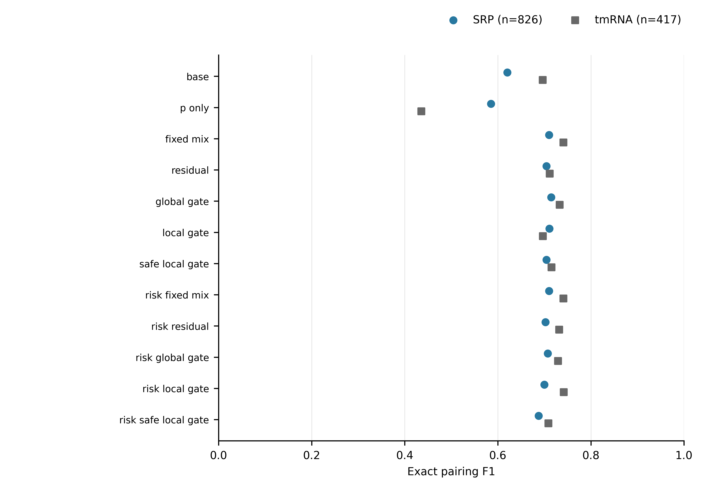
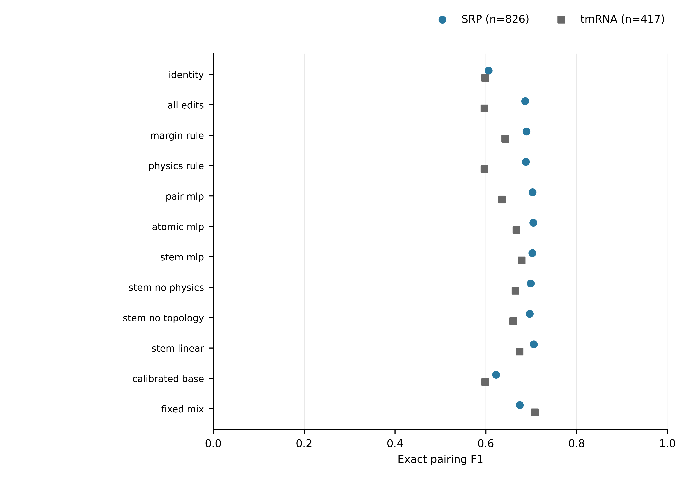

# Direction A Stage 2：统一校准与结构效用学习

2026-10-23。结论：本阶段已完成训练、评估、独立复算与资源核算，但预先指定的主模型没有通过扩展条件。不启动三种子或九折训练，保留原 v1/R1 的否定决定。本报告属于模型开发证据，不是最终 Family-OOD 测试或论文完成声明。

## 实验范围与公平性

先完成旧 v1 所有冻结检查点的统一扩展阈值/融合强度校准，消除此前只有 fixed_mix 得到扩展校准的比较缺口。检查点保持原选择，未按新网格重选整个训练历史。所有方法使用同一校准数据和同一 base 编辑参考；两种开发情形的选择均在开发评分前封存。缓存可以提前生成无标签 logits，开发标签不参与选择。

第二部分重新构造严格 A/B/C 家族链：A 的旧 B0 检查点冻结；B 上固定训练15轮局部纠错器；C 内按序列组拆分 utility_fit/cal，训练小型效用预测器并选阈值；D 仅评估。没有重训 RiNALMo 或 B0。CPU 运行统一重算 B/C/D 的 FP32 base 分数，避免与旧 BF16 缓存混用。

| 开发家族 D | A：B0训练家族 | B：proposal训练家族 | C：utility训练/校准家族 | B样本 | C fit/cal | D样本 |
|---|---|---|---|---:|---:|---:|
| SRP | 16S、23S、tmRNA | RNaseP、grp1 | tRNA、telomerase | 475 | 427/104 | 826 |
| tmRNA | RNaseP、grp1、telomerase | 23S、SRP | 16S、tRNA | 839 | 450/110 | 417 |

A/B/C/D 家族互斥，精确序列组不跨角色。5S未用于本轮拟合/校准/开发评分；历史 ArchiveII 实验已接触该基准，不能宣称全项目从未见过。未以相似性聚类替代精确去重，预训练暴露也未因此消除。

两个部分的上游角色和 base 不同，必须各自内部比较，不能把第一部分 fixed_mix 的0.7255与第二部分模型的0.6906直接当作架构胜负。

## 统一校准结果

数值为 exact pairing F1（0–1），每家族内部 RNA 等权，最后两家族等权；seed17。完整12方法、precision/recall、flexible F1及编辑统计见 matched_metrics.csv。

| 方法 | SRP | tmRNA | 两家族均值 |
|---|---:|---:|---:|
| Base | 0.620194 | 0.696569 | 0.658381 |
| Fixed mix | 0.710241 | 0.740847 | **0.725544** |
| Residual CNN | 0.704568 | 0.711630 | 0.708099 |
| Global gate | 0.714720 | 0.732936 | 0.723828 |
| Local gate | 0.710648 | 0.696719 | 0.703683 |
| Protected local gate | 0.704392 | 0.715492 | 0.709942 |
| Risk-calibrated local gate | 0.700089 | 0.741560 | 0.720825 |

统一校准后简单融合仍更强。学习方法的不足不能仅归因于之前阈值搜索不公平；也不能据此断言任何学习式融合都无效。当前只覆盖冻结的已选检查点、两个开发家族和一个种子。

## 严格链结构效用实验

输入为不含真值的18维候选编辑特征，涵盖候选大小、茎结构、跨度、base/物理概率、熵与交叉关系。主模型 stem_mlp 只有641参数；与同参数量 pair_mlp、atomic_mlp及去物理/去拓扑消融比较，另有19参数 ridge 线性效用器和简单规则。utility 目标为归一化 ΔTP，由编辑计数推导 ΔFP；候选必须来自 proposal。原子交换路径/环及茎合并保证任意选中子集满足单核苷酸最多一个配对，允许交叉配对。合法性是约束工具，本身不作为新颖性宣称。

| 方法 | SRP F1 | tmRNA F1 | 两家族均值 |
|---|---:|---:|---:|
| Identity | 0.606103 | 0.598607 | 0.602355 |
| 全部 proposal 编辑 | 0.686653 | 0.596928 | 0.641791 |
| Margin rule | 0.689273 | 0.642736 | 0.666004 |
| Physics rule | 0.687948 | 0.597010 | 0.642479 |
| Pair MLP | 0.702777 | 0.635331 | 0.669054 |
| Atomic MLP | 0.704585 | 0.667360 | 0.685973 |
| **Stem MLP（预先指定主模型）** | **0.702499** | **0.678717** | **0.690608** |
| Stem，无物理特征 | 0.698821 | 0.665139 | 0.681980 |
| Stem，无拓扑特征 | 0.696488 | 0.660146 | 0.678317 |
| Stem linear | 0.705472 | 0.674348 | 0.689910 |
| Calibrated base | 0.622590 | 0.598607 | 0.610598 |
| **Fixed mix** | **0.674844** | **0.708114** | **0.691479** |

独立于开发结果，在 C_cal 上选出的强简单对照两次均为 fixed_mix。主模型相对它的 F1 增益为 SRP +0.027655、tmRNA −0.029397、均值 −0.000871。原规则要求均值至少+0.005，任何家族下降不超过0.01，且平均 harmful rate不增加。因此 promotion=false，不能改选开发表现最好的其他方法来绕过规则。

| 方法 | SRP harmful rate | tmRNA harmful rate | 两家族均值 |
|---|---:|---:|---:|
| Fixed mix | 0.471765 | 0.330810 | 0.401287 |
| Stem MLP | 0.362912 | 0.376145 | 0.369528 |

harmful rate 是每条RNA中 harmful/(helpful+harmful) 的均值，无编辑记0；它不是整条RNA预测错误率，identity为0也不意味着预测正确。主模型平均损害比例下降，但 tmRNA 比对照更差；单独汇报总体平均会掩盖家族风险。

## 失败机制与训练趋势

1. **结构聚合有作用，但尚未证明神经模型的额外价值。** Stem MLP 比 pair MLP 的两家族均值高0.021554，去物理或拓扑特征后均值下降；但相对19参数线性模型仅高0.000698，SRP甚至低于线性。单种子两家族无法支持显著性或稳定创新贡献。
2. **proposal 的跨家族质量仍限制上限。** tmRNA上全部编辑甚至低于identity（0.596928 vs 0.598607）。效用器可以过滤损害，却只能从既有候选中选择，无法产生缺失的正确茎。候选覆盖不足是否是主因仍需对当前严格链做可达上限诊断，不能直接套用旧v1的GT oracle。
3. **校准迁移是实质风险。** tmRNA情形 C_cal 的 Stem MLP F1为0.800066，而开发tmRNA为0.678717；fixed_mix分别为0.811786和0.708114。C/D家族差异与模型差异混在一起，此差距不能解释成同分布过拟合或因果证据。
4. **延长轮数尚无充分依据。** 五种MLP在两种情形的 C_cal MSE最低点都在150轮边界，曲线见 utility_learning_curves.csv（1,500条记录）。主模型最后 train/cal MSE为SRP 0.080542/0.076677、tmRNA 0.083541/0.094743。它们是归一化编辑效用回归MSE，不能与结构训练BCE或F1直接比较；训练loss记录在该epoch更新前，cal在更新后。当前没有观察到C_cal曲线后期反弹，但150轮不是已证实的充分收敛点，更不能证明D上没有过拟合。优先解决候选与目标失配，再决定是否增加训练预算。

## 审计、工程问题与资源

两部分各12方法×1,243条RNA，均经官方独立评分函数复算14,916条预测视图；总计29,832。另从原CT重建编辑指标，核对 cohort、序列、配对合法性、checkpoint/source/choice/prediction散列。完整67项测试通过。

首次旧报告因JSON的list配对不可哈希而失败。保留已冻结的缓存和选择源文件，新增规范化审计入口，回归测试通过后只重跑审计，没有重训或放宽断言。微型smoke曾因空候选停止，随后明确smoke只验证真实proposal梯度和推理；正式utility训练使用真实候选，未填充伪造数据。

GPU排队预计数小时，先用62秒CPU实测，再将两项正式试验迁移到CPU；取消的两项GPU作业均分配0秒。全部18项本阶段作业已终止：14完成、2失败、2取消。详见 resource_usage.csv 和原始 resource_sacct.psv。

| 部分 | GPU分配小时 | CPU核时（含GPU作业内CPU） |
|---|---:|---:|
| 统一校准与审计 | 0.073889 | 1.598889 |
| 结构效用、实测及审计 | 0.004167 | 3.218889 |
| 本阶段合计 | **0.078056（281秒）** | **4.817778** |

核算包含失败；排队时间、轻量控制进程与本地图表整理不计入Slurm分配量。正式两项CPU拟合耗时分别15分和11分29秒。未追加大模型权重下载，未占用九折训练资源。原v1/R1成本单独保留，不计入本阶段新增量。

## 对论文的贡献与下一步

本阶段交付了可复现的否定证据、匹配的强对照及严格上游隔离的候选筛选实验，尚不足以提交方法论文。不能将单种子消融、GT oracle、标准匹配合法性或不足0.001的线性对照差距包装为创新。

下一步优先级已经确定：先对当前严格链输出做低成本诊断，再决定是否训练一个修订模型，暂不重复多种子和九折。

| 优先级 | 可执行工作 | 能回答的论文问题 | 上限与继续条件 |
|---|---|---|---|
| 1 | 只读当前预测，比较base/proposal/固定融合的正确茎覆盖、可达编辑oracle、长度/交叉结构/编辑规模分层；同时检查C_cal和D的特征/收益漂移 | 候选不足还是效用估计失效？ | 优先CPU，最多1核时；GT只用于事后诊断，不进入部署策略或调参 |
| 2 | 若存在可达收益且物理融合提供proposal缺失的正确茎，构造base与物理来源的候选并集，再做冲突安全选择；若候选充分，则改为收益排序/实际F1增益目标并使用保守回退 | 结构候选覆盖与可靠编辑是否优于纯分数融合？ | 只选一个有诊断支撑的修订；两开发家族、seed17，最多1GPUh或4CPU核时；事先封存新条件 |
| 3 | 与固定融合、当前641参数MLP及19参数线性模型等预算比较；两开发家族过门槛后才跑17/23/41 | 创新是否超过廉价强对照且稳定？ | 沿用均值+0.005、无家族下降>0.01、损害不增加；不得事后挑家族/指标 |
| 4 | 稳定后才确定外部未用于设计的数据、第二预测头/编码器，再开展正式冻结评估 | 是否具有跨模型/跨分布意义？ | 预先审计同源性与预训练暴露；ArchiveII九折只能作为设计已暴露的基准 |

以上是下一阶段方案，尚未执行或声称成功。若后续仍不能超过固定融合/线性对照，应停止继续堆模块，将工作转向可验证的泛化诊断或可靠性研究，而不是扩大负结果的训练规模。

## 复现与图表

规范统一校准审计：`sbatch slurm/direction_a_matched_audit.sbatch`。冻结的旧runner中legacy report不作为入口。

结构效用CPU：`sbatch slurm/direction_a_utility_cpu.sbatch fit --case srp`（已有正式输出时会拒绝重训）；两情形封存后使用同脚本 evaluate，再执行 report。CPU环境须一致，不能用默认CUDA入口加载CPU源绑定实验。

汇总图表：`python scripts/report_direction_a_stage2.py`，需要服务器原始封存选择/曲线与本目录审计CSV。输出不含新拟合。公开图表源数据已随本目录提供。预测与checkpoint保留服务器既定outputs目录。

图均保留12方法×2家族全部数据；固定F1轴0–1，点形状与颜色同时区分家族。Seed17、无置信区间/显著性主张，不能跨图比较上游训练不同的方法。PDF/SVG为可编辑矢量，PNG仅预览。
