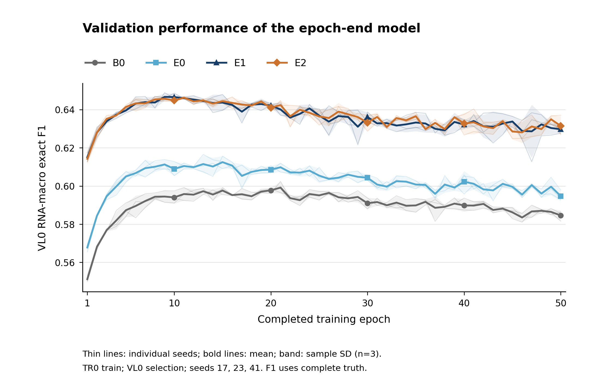
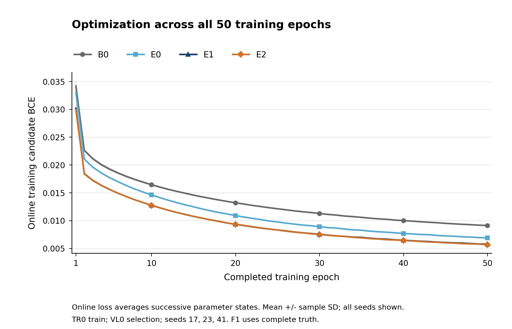
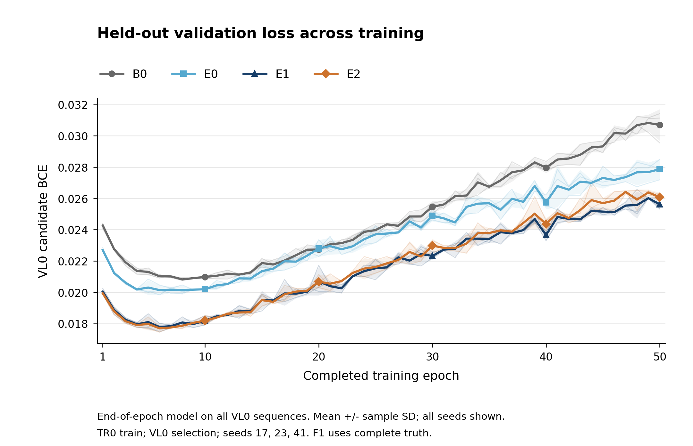
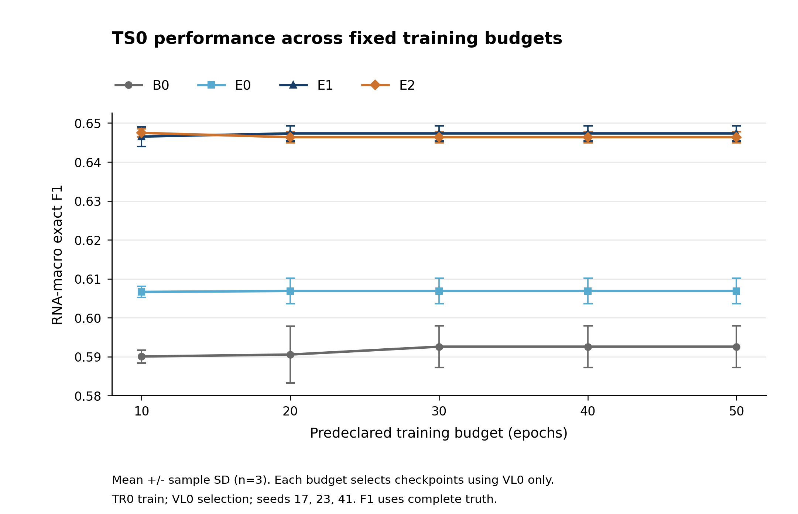
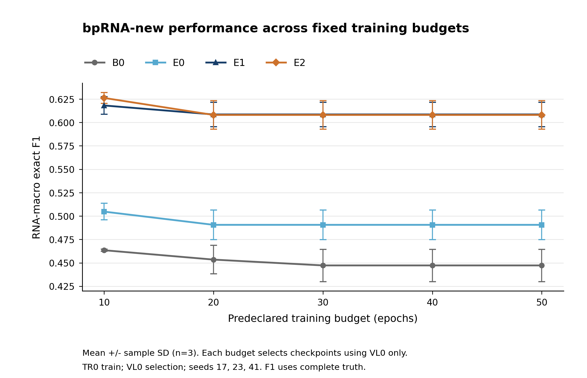
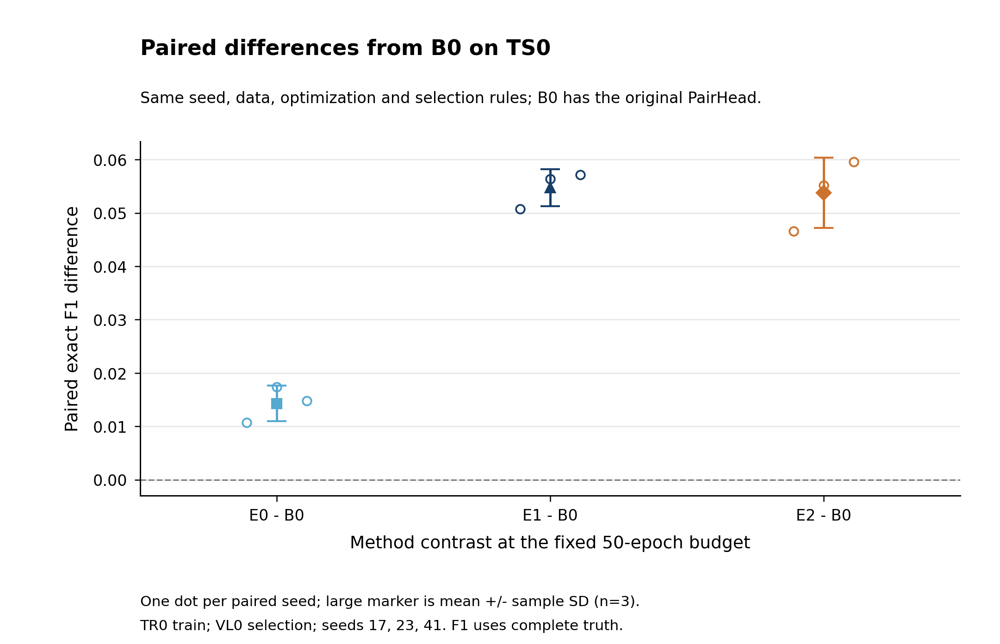
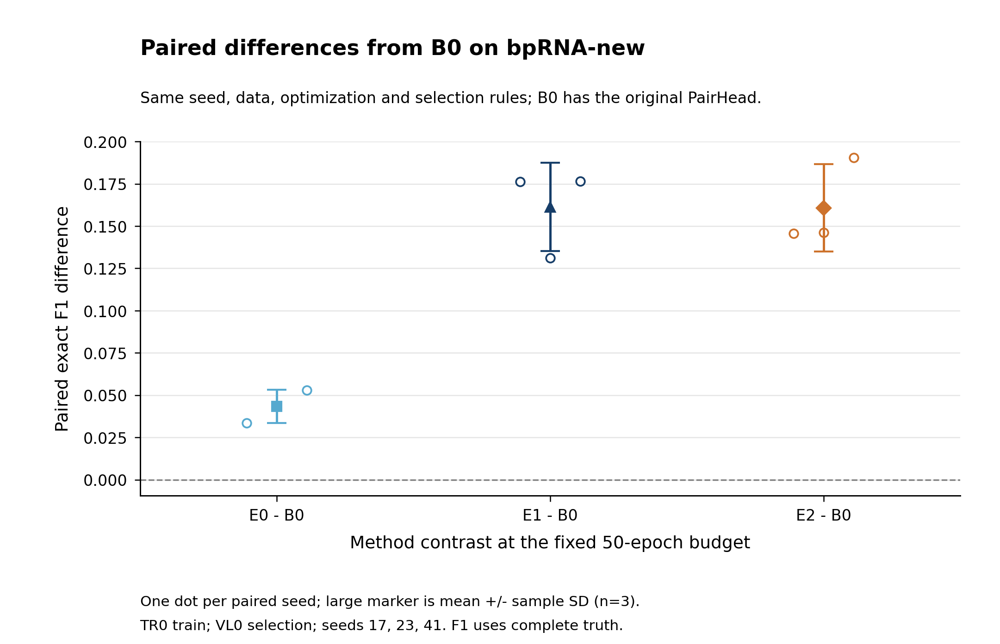

# B0 / E 系列 50 轮训练研究

12条轨迹全部完成50轮。训练为完整 TR0 10,682条，VL0 1,286条用于验证和选择，TS0 1,288条及 bpRNA-new 5,388条用于固定预算测试；种子17、23、41。每个预算内先选各自 VL0 最佳 epoch，再选择方法共享阈值，全部60个选择统一锁定后才提交测试。测试结果不用于决定预算。

## 50轮预算下的最终效果

下表为预算内所选模型的完整真值 RNA-macro exact F1，均值 ± 三种子样本 SD。

| 方法 | VL0（选择集） | TS0 | bpRNA-new |
|---|---:|---:|---:|
| B0 | 0.599933 ± 0.002188 | 0.592580 ± 0.005368 | 0.447211 ± 0.017243 |
| E0_no_thermo | 0.613331 ± 0.002341 | 0.606881 ± 0.003306 | 0.490575 ± 0.015918 |
| E1_bpp | 0.648443 ± 0.000491 | 0.647345 ± 0.001965 | 0.608500 ± 0.012973 |
| E2_bpp_stack | 0.646004 ± 0.001164 | 0.646372 ± 0.001406 | 0.607976 ± 0.015212 |

## 增加轮数的收益与代价

以下“最后轮 F1”使用该轮的 VL0 阈值网格最大 F1；与后文预算内选出的最佳模型分开报告。

- B0：10→30轮，VL0 最后轮 F1 变化 -0.0030；30→50轮变化 -0.0064。累计训练时间从 23.0 分钟增加到 68.6 / 113.8 分钟。50轮平均峰值回落 0.0155；最佳 epoch 分别为 21, 11, 17。
  在预算内选择的模型上，30→50轮的 TS0 / bpRNA-new 平均 F1 变化分别为 +0.0000 / +0.0000，额外训练 45.2 分钟（每种子均值）。这些是预定预算的描述性比较，不据测试分数挑选预算。
  在线训练 BCE（10/30/50轮）为 0.01643 / 0.01126 / 0.00911；同期 VL0 BCE 为 0.02098 / 0.02547 / 0.03070。结合逐种子曲线判断后期变化，不能仅凭训练损失给出泛化结论。
  3/3 个种子同时出现：50轮训练 BCE 低于10轮、验证 BCE 高于10轮、轮末 F1 比本轨迹峰值低超过0.001。这为后期过拟合提供联合观察证据，仍是描述性判断。 10→50轮累计训练段时间增加到 4.95 倍，预算内所选 VL0 平均 F1 变化 +0.0048。
- E0_no_thermo：10→30轮，VL0 最后轮 F1 变化 -0.0046；30→50轮变化 -0.0096。累计训练时间从 29.3 分钟增加到 87.8 / 146.0 分钟。50轮平均峰值回落 0.0205；最佳 epoch 分别为 15, 7, 13。
  在预算内选择的模型上，30→50轮的 TS0 / bpRNA-new 平均 F1 变化分别为 +0.0000 / +0.0000，额外训练 58.2 分钟（每种子均值）。这些是预定预算的描述性比较，不据测试分数挑选预算。
  在线训练 BCE（10/30/50轮）为 0.01461 / 0.00889 / 0.00689；同期 VL0 BCE 为 0.02019 / 0.02489 / 0.02787。结合逐种子曲线判断后期变化，不能仅凭训练损失给出泛化结论。
  3/3 个种子同时出现：50轮训练 BCE 低于10轮、验证 BCE 高于10轮、轮末 F1 比本轨迹峰值低超过0.001。这为后期过拟合提供联合观察证据，仍是描述性判断。 10→50轮累计训练段时间增加到 4.98 倍，预算内所选 VL0 平均 F1 变化 +0.0021。
- E1_bpp：10→30轮，VL0 最后轮 F1 变化 -0.0104；30→50轮变化 -0.0064。累计训练时间从 31.6 分钟增加到 89.6 / 147.3 分钟。50轮平均峰值回落 0.0187；最佳 epoch 分别为 9, 15, 10。
  在预算内选择的模型上，30→50轮的 TS0 / bpRNA-new 平均 F1 变化分别为 +0.0000 / +0.0000，额外训练 57.7 分钟（每种子均值）。这些是预定预算的描述性比较，不据测试分数挑选预算。
  在线训练 BCE（10/30/50轮）为 0.01275 / 0.00755 / 0.00576；同期 VL0 BCE 为 0.01818 / 0.02233 / 0.02563。结合逐种子曲线判断后期变化，不能仅凭训练损失给出泛化结论。
  3/3 个种子同时出现：50轮训练 BCE 低于10轮、验证 BCE 高于10轮、轮末 F1 比本轨迹峰值低超过0.001。这为后期过拟合提供联合观察证据，仍是描述性判断。 10→50轮累计训练段时间增加到 4.67 倍，预算内所选 VL0 平均 F1 变化 +0.0013。
- E2_bpp_stack：10→30轮，VL0 最后轮 F1 变化 -0.0117；30→50轮变化 -0.0017。累计训练时间从 28.8 分钟增加到 92.8 / 151.6 分钟。50轮平均峰值回落 0.0150；最佳 epoch 分别为 16, 11, 8。
  在预算内选择的模型上，30→50轮的 TS0 / bpRNA-new 平均 F1 变化分别为 +0.0000 / +0.0000，额外训练 58.9 分钟（每种子均值）。这些是预定预算的描述性比较，不据测试分数挑选预算。
  在线训练 BCE（10/30/50轮）为 0.01272 / 0.00750 / 0.00566；同期 VL0 BCE 为 0.01819 / 0.02299 / 0.02609。结合逐种子曲线判断后期变化，不能仅凭训练损失给出泛化结论。
  3/3 个种子同时出现：50轮训练 BCE 低于10轮、验证 BCE 高于10轮、轮末 F1 比本轨迹峰值低超过0.001。这为后期过拟合提供联合观察证据，仍是描述性判断。 10→50轮累计训练段时间增加到 5.27 倍，预算内所选 VL0 平均 F1 变化 +0.0002。

训练损失下降但 VL0 BCE 上升、VL0 F1 从峰值回落是后期过拟合的观察指标。峰值回落不等于显著性结论；应结合全部三个种子曲线和 validation_bce 判断。最佳值曲线的单调性来自选择规则，不能据此声称轮末模型持续改善。在线训练 BCE 使用每步更新中的参数，VL0 BCE 使用轮末参数，二者不能直接相减为精确泛化间隙。

收敛速度见 convergence_by_seed.csv：预先规定达到最大 VL0 F1 的95%，以及距最大值不超过0.001的首次 epoch 与累计训练时间。这些指标需要完整轨迹的峰值，是事后收敛描述，不是可直接在线执行的停止规则。所有逐轮数据保留在 epoch_curves.csv，包含候选 micro accuracy / balanced accuracy 与时长；候选 accuracy 易被大量负配对抬高，不能代替结构 F1。

| 方法 | 最佳epoch（17/23/41） | 首次达到峰值95%的平均epoch | 首次距峰值≤0.001的平均epoch | 50轮训练分钟/种子 | 本阶段新增训练分钟/种子 |
|---|---|---:|---:|---:|---:|
| B0 | 21, 11, 17 | 3.0 | 15.3 | 113.8 ± 48.9 | 113.8 |
| E0_no_thermo | 15, 7, 13 | 2.3 | 11.7 | 146.0 ± 2.2 | 116.7 |
| E1_bpp | 9, 15, 10 | 1.7 | 11.3 | 147.3 ± 3.3 | 115.7 |
| E2_bpp_stack | 16, 11, 8 | 1.7 | 7.7 | 151.6 ± 9.8 | 123.9 |

12条完整轨迹累计训练段成本 27.93 GPU小时；其中本阶段新增训练段 23.50 GPU小时。各训练作业申请一张GPU，上述数值为完整训练轮段的分配时间，验证、前缀诊断、最终测试及排队另计；并行作业的累计GPU小时不能当成用户等待的墙钟时间。

## B0 的过程与公平性

B0 是原始175,553参数 PairHead，保留原有卷积残差块，不含额外的 CorrectionCNN，不读取 P/Q/距离作为模型证据；E系列为186,306参数。同一随机种子的四个 PairHead 初始化逐张量相同，B0和E使用相同训练集合、候选损失、优化器、BF16、梯度累积、解码、完整真值、验证与测试规则。B0从头训练50轮，E从已验证的最后 epoch 与 AdamW 状态继续至50轮；继承前缀的每轮VL0曲线重新推理并精确重现，旧输出保持原样。E2/seed23的旧轨迹在9轮早停，本次从第10轮继续。

全部方法关闭提前停止，以完整观测50轮轨迹；学习率固定1e-4，没有新增调度器。历史10轮上限+patience3的表格单独保存在 historical_10_epoch_with_early_stopping.csv，不能与本研究的固定10轮前缀视为完全相同停止策略，也不混入此前家族留出 B0 的开发分数。

以下按相同种子计算50轮预算所选模型的 F1 差值，正数表示 E 优于 B0。配对差值的 SD 是三个种子差值的样本 SD，不从两组边际 SD 推算；三个种子不构成统计显著性的证据。

| 比较 | 集合 | 配对F1差值均值 ± SD | 正差值种子数 |
|---|---|---:|---:|
| E0_no_thermo − B0 | TS0 | +0.014301 ± 0.003368 | 3/3 |
| E0_no_thermo − B0 | bprna_new | +0.043364 ± 0.009822 | 3/3 |
| E1_bpp − B0 | TS0 | +0.054765 ± 0.003475 | 3/3 |
| E1_bpp − B0 | bprna_new | +0.161289 ± 0.026174 | 3/3 |
| E2_bpp_stack − B0 | TS0 | +0.053793 ± 0.006603 | 3/3 |
| E2_bpp_stack − B0 | bprna_new | +0.160765 ± 0.025767 | 3/3 |

时间为实际测得的完整轮训练段时间，包含继承轨迹的已发生训练成本；本阶段新增成本和诊断成本另列 trajectory_summaries.json。若从检查点重启，summary 的 new_stage_wall_seconds 只描述最后一次进程运行。各作业采用单GPU的 Slurm 分配；集群排队、节点负载、实际GPU竞争和前缀复用会影响墙钟时间，不把这些差异解释为方法计算效率的差异。种子SD不等于置信区间。

## 资源竞争与检查点续训记录

E2/seed41 原作业 9173 的分配 GPU 上出现另一个不属于该作业的计算进程，占用约 18.2 GiB 显存。通过 Slurm 先申请空闲 GPU 后，主动取消原分配，以作业 9175 从第 18 轮继续；保留前 17 轮的逐项记录、参数、AdamW 和随机数状态。AdamW 步数从 45,407 连续增加到 48,078。数值代码、输入和超参数均未改变，原有前缀的完整内容哈希一致。迁移前 7 个完整新轮平均 334.8 秒，迁移后最初 3 个完整轮平均 166.8 秒；这是消除资源竞争的观察，不代表算法本身加速。

25个最终准备/训练/测试作业均为 COMPLETED、ExitCode 0:0；含被替代尝试共提交 26 个不同作业ID。previous_slurm_jobs.json 与 slurm_all_attempts.txt 保留主动取消及所有最终作业的状态、开始/结束时间和分配秒数。由于所有这些作业均申请一张GPU，本阶段所有尝试累计 GPU 分配时长为 26.90 小时（含准备、验证、测试、重新加载及取消前的部分轮；不含排队，也不含此前10轮阶段）。

逐轮时间图仅统计完成且保留的 epoch 训练段，未完成轮的部分工作、迁移时短暂重叠的资源预留和重新加载没有混入这些曲线，均包含在全部尝试的 Slurm 分配时长中。RiNALMo 表征预处理是此前完成的共同步骤，不包含在本阶段的训练轮数成本比较中。

## 固定预算性能比较

| 方法 | 预算轮数 | 所选epoch（17/23/41） | VL0 | TS0 | bpRNA-new |
|---|---:|---|---:|---:|---:|
| B0 | 10 | 8,9,9 | 0.595124 ± 0.002148 | 0.590059 ± 0.001656 | 0.463452 ± 0.001102 |
| B0 | 20 | 15,11,17 | 0.596069 ± 0.004873 | 0.590553 ± 0.007266 | 0.453432 ± 0.015277 |
| B0 | 30 | 21,11,17 | 0.599933 ± 0.002188 | 0.592580 ± 0.005368 | 0.447211 ± 0.017243 |
| B0 | 40 | 21,11,17 | 0.599933 ± 0.002188 | 0.592580 ± 0.005368 | 0.447211 ± 0.017243 |
| B0 | 50 | 21,11,17 | 0.599933 ± 0.002188 | 0.592580 ± 0.005368 | 0.447211 ± 0.017243 |
| E0_no_thermo | 10 | 9,7,9 | 0.611268 ± 0.002361 | 0.606643 ± 0.001392 | 0.504694 ± 0.008873 |
| E0_no_thermo | 20 | 15,7,13 | 0.613331 ± 0.002341 | 0.606881 ± 0.003306 | 0.490575 ± 0.015918 |
| E0_no_thermo | 30 | 15,7,13 | 0.613331 ± 0.002341 | 0.606881 ± 0.003306 | 0.490575 ± 0.015918 |
| E0_no_thermo | 40 | 15,7,13 | 0.613331 ± 0.002341 | 0.606881 ± 0.003306 | 0.490575 ± 0.015918 |
| E0_no_thermo | 50 | 15,7,13 | 0.613331 ± 0.002341 | 0.606881 ± 0.003306 | 0.490575 ± 0.015918 |
| E1_bpp | 10 | 9,10,10 | 0.647173 ± 0.002680 | 0.646526 ± 0.002507 | 0.618096 ± 0.009508 |
| E1_bpp | 20 | 9,15,10 | 0.648443 ± 0.000491 | 0.647345 ± 0.001965 | 0.608500 ± 0.012973 |
| E1_bpp | 30 | 9,15,10 | 0.648443 ± 0.000491 | 0.647345 ± 0.001965 | 0.608500 ± 0.012973 |
| E1_bpp | 40 | 9,15,10 | 0.648443 ± 0.000491 | 0.647345 ± 0.001965 | 0.608500 ± 0.012973 |
| E1_bpp | 50 | 9,15,10 | 0.648443 ± 0.000491 | 0.647345 ± 0.001965 | 0.608500 ± 0.012973 |
| E2_bpp_stack | 10 | 9,6,8 | 0.645788 ± 0.000832 | 0.647474 ± 0.001016 | 0.626139 ± 0.005850 |
| E2_bpp_stack | 20 | 16,11,8 | 0.646004 ± 0.001164 | 0.646372 ± 0.001406 | 0.607976 ± 0.015212 |
| E2_bpp_stack | 30 | 16,11,8 | 0.646004 ± 0.001164 | 0.646372 ± 0.001406 | 0.607976 ± 0.015212 |
| E2_bpp_stack | 40 | 16,11,8 | 0.646004 ± 0.001164 | 0.646372 ± 0.001406 | 0.607976 ± 0.015212 |
| E2_bpp_stack | 50 | 16,11,8 | 0.646004 ± 0.001164 | 0.646372 ± 0.001406 | 0.607976 ± 0.015212 |

## 轮末损失和训练成本

| 方法 | 轮数 | 在线训练BCE | VL0 BCE | 候选balanced accuracy | 累计训练分钟 |
|---|---:|---:|---:|---:|---:|
| B0 | 10 | 0.016429 ± 0.000134 | 0.020980 ± 0.000080 | 0.749295 ± 0.007616 | 23.0 ± 9.6 |
| B0 | 20 | 0.013185 ± 0.000085 | 0.022733 ± 0.000165 | 0.765986 ± 0.008576 | 45.9 ± 19.3 |
| B0 | 30 | 0.011261 ± 0.000045 | 0.025467 ± 0.000387 | 0.760807 ± 0.002993 | 68.6 ± 29.2 |
| B0 | 40 | 0.009982 ± 0.000071 | 0.027969 ± 0.000343 | 0.769737 ± 0.007601 | 91.2 ± 39.0 |
| B0 | 50 | 0.009108 ± 0.000028 | 0.030704 ± 0.001010 | 0.762489 ± 0.003555 | 113.8 ± 48.9 |
| E0_no_thermo | 10 | 0.014609 ± 0.000072 | 0.020192 ± 0.000041 | 0.774113 ± 0.006382 | 29.3 ± 0.8 |
| E0_no_thermo | 20 | 0.010890 ± 0.000082 | 0.022804 ± 0.000532 | 0.789118 ± 0.011424 | 58.5 ± 0.5 |
| E0_no_thermo | 30 | 0.008893 ± 0.000062 | 0.024893 ± 0.000350 | 0.789631 ± 0.016601 | 87.8 ± 0.7 |
| E0_no_thermo | 40 | 0.007665 ± 0.000087 | 0.025751 ± 0.000422 | 0.773092 ± 0.013593 | 116.9 ± 1.4 |
| E0_no_thermo | 50 | 0.006885 ± 0.000066 | 0.027870 ± 0.000654 | 0.777913 ± 0.002476 | 146.0 ± 2.2 |
| E1_bpp | 10 | 0.012753 ± 0.000091 | 0.018184 ± 0.000293 | 0.804631 ± 0.006454 | 31.6 ± 3.5 |
| E1_bpp | 20 | 0.009338 ± 0.000052 | 0.020699 ± 0.000897 | 0.820767 ± 0.015558 | 60.7 ± 3.6 |
| E1_bpp | 30 | 0.007547 ± 0.000069 | 0.022325 ± 0.000226 | 0.808009 ± 0.011477 | 89.6 ± 3.6 |
| E1_bpp | 40 | 0.006453 ± 0.000047 | 0.023653 ± 0.000314 | 0.796689 ± 0.013322 | 118.5 ± 3.4 |
| E1_bpp | 50 | 0.005764 ± 0.000042 | 0.025628 ± 0.000357 | 0.798706 ± 0.002642 | 147.3 ± 3.3 |
| E2_bpp_stack | 10 | 0.012724 ± 0.000062 | 0.018189 ± 0.000282 | 0.800561 ± 0.006215 | 28.8 ± 0.1 |
| E2_bpp_stack | 20 | 0.009315 ± 0.000107 | 0.020680 ± 0.000428 | 0.815686 ± 0.013940 | 64.1 ± 10.5 |
| E2_bpp_stack | 30 | 0.007496 ± 0.000106 | 0.022985 ± 0.000428 | 0.800908 ± 0.009721 | 92.8 ± 9.3 |
| E2_bpp_stack | 40 | 0.006424 ± 0.000115 | 0.024362 ± 0.000392 | 0.802226 ± 0.006809 | 121.9 ± 9.1 |
| E2_bpp_stack | 50 | 0.005658 ± 0.000059 | 0.026085 ± 0.000287 | 0.810250 ± 0.002937 | 151.6 ± 9.8 |

## 产物与复核

固定预算共 180 个方法/种子/预算/集合组合，对应 477,720 条逻辑预测。相同checkpoint/阈值/集合的重复组合复用完全相同、校验SHA256的预测文件；独立复算 69 份不同预测文件、183,126 条独立记录。完整选择锁定、源代码指纹、逐种子结果、配对差值和检查记录随报告保存。

服务器模型及逐RNA预测在 outputs/long_epochs/，表征复用 embeddings/full/。图表、脚本及源数据与报告统一管理。历史测试集曾出现在项目方法决策材料中，本研究保持预先固定的预算与选择规则，不声称整个项目历史从未查看这些测试集。

## 图表与源数据

图表由 `python scripts/plot_long_epochs.py` 在上述真实结果验证后生成。细线为各种子，粗线为均值，阴影或误差线为三种子样本SD；不平滑、不剔除数据。可编辑SVG/PDF、300dpi PNG、数据哈希和实际字体/碰撞检查见 [figures/figure_manifest.json](figures/figure_manifest.json)。每张单图使用自己的清晰轴范围，跨图数值比较须读取刻度。

其余两张图为 [验证选择包络](figures/validation_best_so_far.png) 和 [验证收益与训练耗时](figures/validation_vs_time.png)。选择包络单调来自规则，不能视为轮末性能持续改善。
